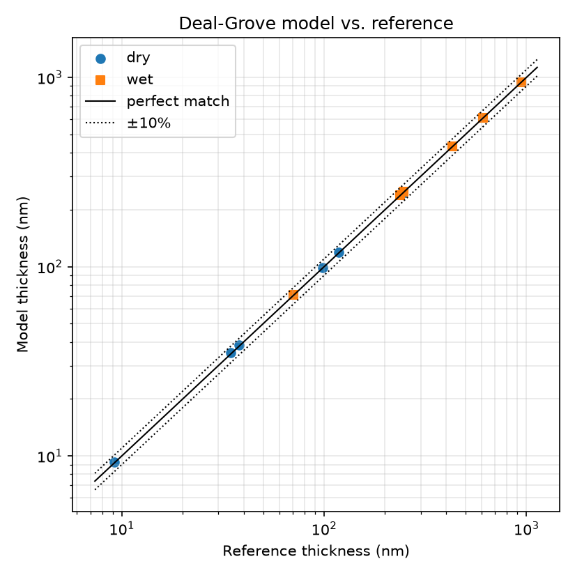
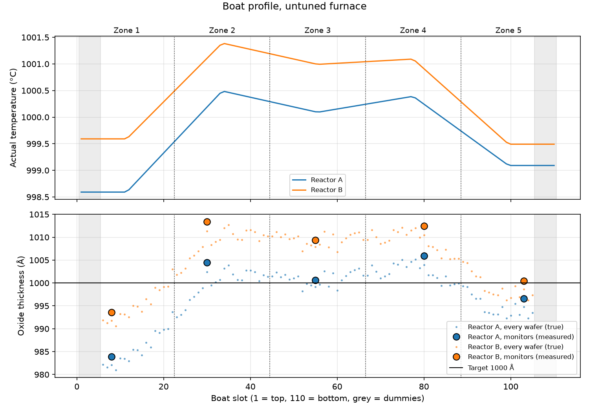
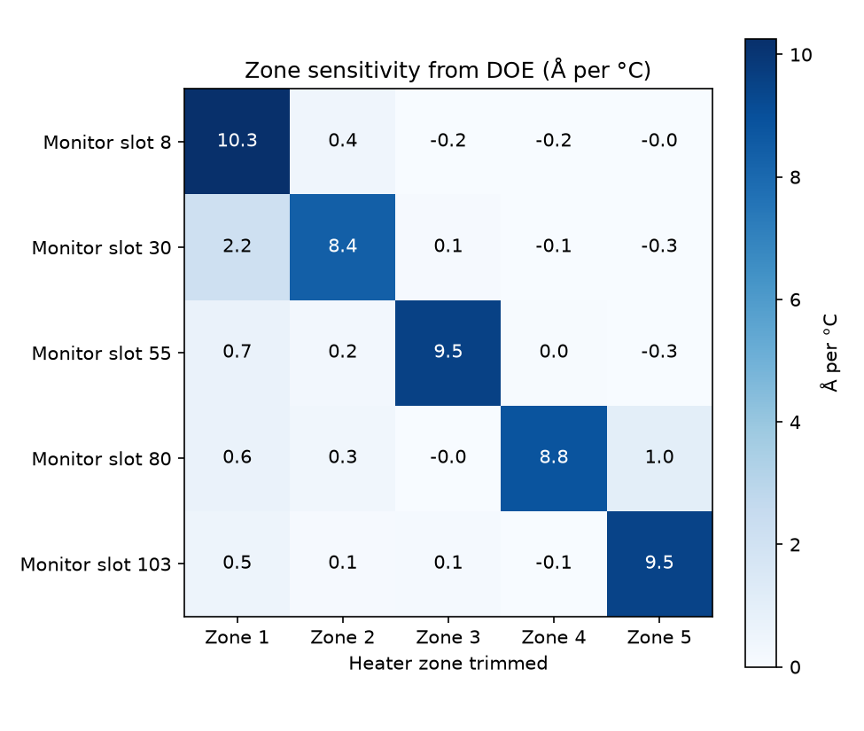
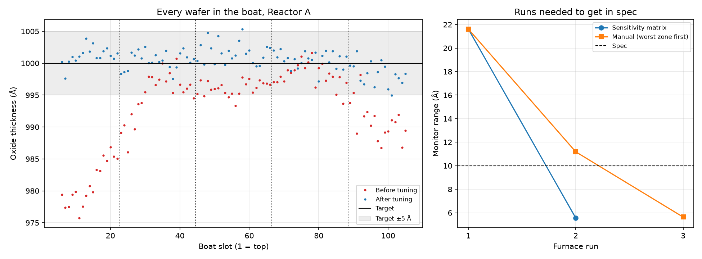
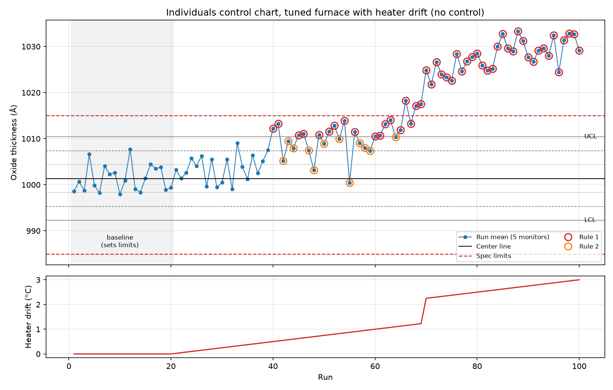
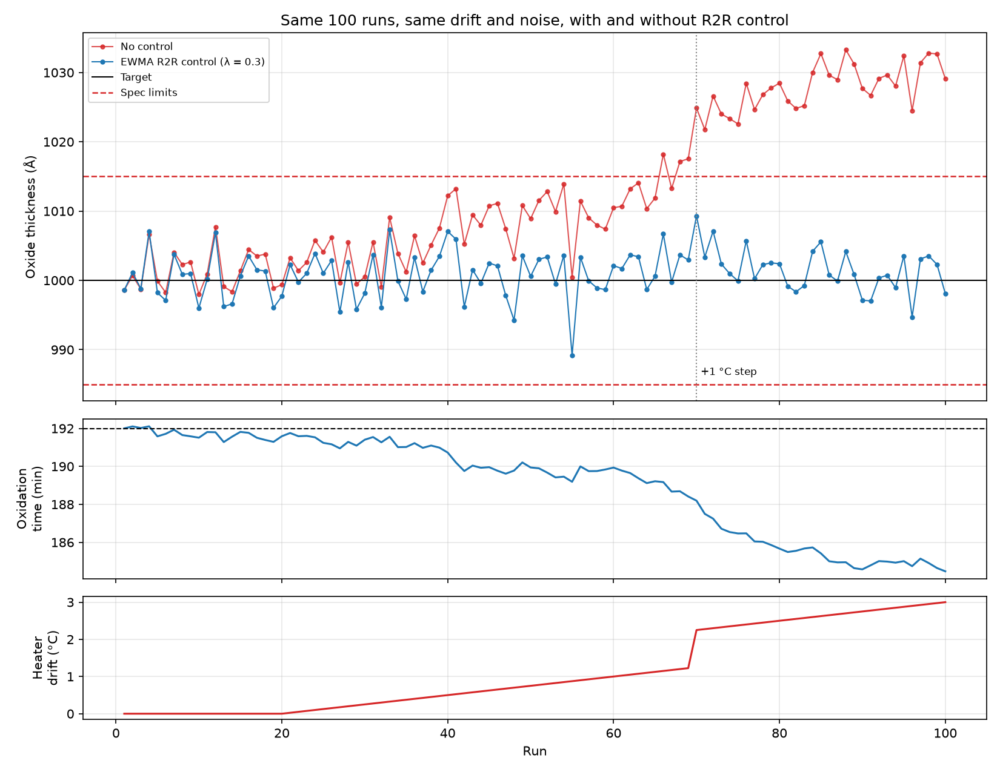
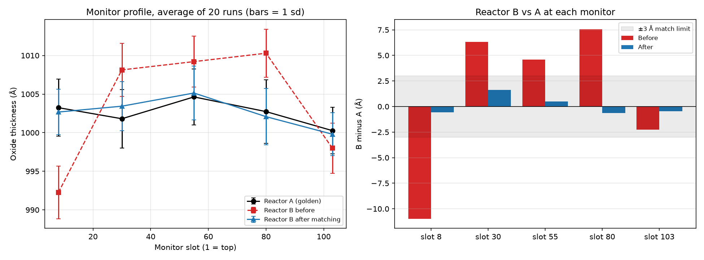

# Batch Furnace Uniformity & Drift Control

**[▶ Try the live demo](https://furnace-control.streamlit.app/)**: move the zone trims, turn R2R control on and off, and match the reactors in your browser.


**Problem:** Vertical batch furnaces don't grow the same oxide on every wafer. Wafers at different boat positions see different temperatures and gas conditions, heaters drift as they age, and the two reactors on a dual-reactor tool rarely match. Fixing this by trial and error costs tool time, monitor wafers and engineering hours.

**What this project does:** It builds a physics-based simulator of a dual-reactor vertical oxidation furnace, then works through three real process engineering problems on it, the same way they'd be handled on the floor: **symptom → data → root cause → fix → verify.**

| | Problem | Method | Result |
|---|---|---|---|
| **Case 1** | Top of the boat grows thin | 2^(5-1) fractional factorial DOE → zone sensitivity matrix → solve for zone offsets | Wafer-to-wafer range **25.9 → 10.4 Å (−60%)**, nonuniformity 1.30% → 0.52%, ~30% fewer tuning runs than a worst-zone-first approach (200 simulated sessions) |
| **Case 2** | Heater drift pushes thickness out of spec | Individuals control chart + Western Electric rules, then EWMA run-to-run control on oxidation time | SPC flagged the drift **26 runs** before the first out-of-spec run. R2R cut out-of-spec runs **34 → 0 of 100** and raised Ppk **0.06 → 1.40** |
| **Case 3** | Reactor B doesn't match Reactor A | Match B to A's monitor profile using A's DOE matrix, half-step corrections | Worst slot mismatch **11.0 → 1.6 Å**, no slot significantly different after matching, and no second DOE needed |

The simulator's oxidation model was first verified against the BYU Cleanroom oxide calculator across 12 conditions: **0.7% average error, 1.3% worst case.**

> Everything here runs on a simulator. The furnace architecture follows public descriptions of the ASM A400 DUO, and every illustrative value (zone offsets, depletion, noise, drift, spec limits) is labeled as such in `src/config.py`. Nothing comes from a production tool, recipe or spec.

---

## How it fits together

```
deal_grove.py     oxide growth physics (Deal-Grove)
      │
validate.py       check the physics against an outside calculator
      │
furnace.py        virtual A400-style furnace: 110-slot boat, 5 heater zones,
config.py         gas depletion, noise, 9-site monitor measurements
      │
doe.py            fractional factorial DOE → zone sensitivity matrix
      │
      ├── zone_tuning.py   Case 1: flatten the boat
      ├── spc.py           Case 2: catch the drift
      ├── r2r.py           Case 2: correct the drift
      └── matching.py      Case 3: match Reactor B to A
```

---

## Model validation

The Deal-Grove model in `deal_grove.py` was compared against the [BYU Cleanroom oxide calculator](https://cleanroom.byu.edu/oxidetimecalc) for dry and wet oxidation, 900–1100 °C, 0.5–4 hr.



Average error was 0.7%, worst 1.3%. The model came out slightly thicker than BYU at **all 12 points**, so the difference is a consistent bias, most likely from small differences in rate constants, not random error. Because BYU also uses Deal-Grove, this verifies the implementation rather than the physics. Deal-Grove is known to underpredict very thin dry oxides (below ~25 nm).

---

## Case 1: The top of the boat comes out thin

**Symptom.** On the untuned furnace, the top monitor grows ~984 Å while the middle of the boat sits around 1000–1006 Å.



**Root cause.** Two effects stack up at the top of the boat: the end zone runs cool because the ends of the tube lose heat, and the oxidant is most depleted there because gas enters at the bottom.

**Finding the fix.** A 2^(5-1) fractional factorial (16 runs + 3 center points, zones at ±3 °C, randomized run order) measured how much each zone moves each monitor. Each zone mostly moves its own monitor (~9–10 Å/°C), with spill-over into neighboring zones, so the zones can't be fixed one at a time.



R² was 0.98–0.99 for every monitor, the center points showed no curvature, and the DOE landed within 6% of the true noise-free sensitivity. I tried ±2 °C first, but run-to-run noise threw the estimates off by up to 9%.

**Fix and verify.** The sensitivity matrix turns the five monitor errors into the five zone offsets that cancel them all at once (mainly +2 °C on zone 1). The furnace is then rerun to confirm.



| | Before | After |
|---|---|---|
| Wafer-to-wafer range (100 wafers) | 25.9 Å | 10.4 Å |
| Nonuniformity | 1.30% | 0.52% |
| Avg runs to spec (200 sessions) | 3.03 (manual) | 2.42 (matrix) |

**Limit.** With 5 monitors for 100 wafers, the profile can only be flattened at the monitors. The depletion slope within each zone is still there, so more monitors or a gas-flow change would be the next lever.

---

## Case 2: Heater drift

**Symptom.** A tuned furnace doesn't stay tuned. After run 20 the heaters drift up 0.025 °C per run, and at run 70 there's a sudden +1 °C step, like after a maintenance event.

**Catching it (SPC).** Run averages go on an individuals control chart with limits from 20 stable runs (sigma from the average moving range), checked against all four Western Electric rules.



No false alarms during the stable period. SPC flagged the drift at run 40, **26 runs before** the first out-of-spec run at run 66. Left alone, 34 of 100 runs went out of spec.

**Correcting it (EWMA R2R).** After every run, an EWMA controller estimates how far off the process is and adjusts the next run's oxidation time to cancel it. The controller gain (Å per hour) comes from Deal-Grove at the recipe conditions.



Same 100 runs, same drift and noise, so the controller is the only difference:

| Method | Mean (Å) | SD (Å) | Ppk | Out of spec |
|---|---|---|---|---|
| No control | 1012.8 | 11.23 | 0.06 | 34 / 100 |
| EWMA λ = 0.1 | 1002.8 | 3.76 | 1.08 | 0 / 100 |
| **EWMA λ = 0.3** | **1001.0** | **3.34** | **1.40** | **0 / 100** |
| EWMA λ = 0.6 | 1000.5 | 3.58 | 1.35 | 0 / 100 |

λ = 0.1 lags behind the drift and λ = 0.6 chases noise, so λ = 0.3 is the best balance. Ppk uses the overall sigma of all 100 runs, which is the honest choice when the data contains drift.

**The catch.** With R2R on, the thickness chart looks clean, but the heaters are still drifting. By run 100 the controller has cut 7.5 minutes from the recipe to compensate (middle panel). The drift moves from the thickness chart to the controller's adjustments, so those need to be charted too, or nobody notices the heaters need service until the controller runs out of room.

---

## Case 3: Reactor B doesn't match Reactor A

**Symptom.** Out of the box, Reactor B's top monitor is 11 Å thinner than A's and its middle monitors are 5–8 Å thicker.

**Why averages aren't enough.** The thin top and thick middle cancel out, so B's run average lands within 1 Å of A's and a t-test on averages says they match (p = 0.30). Slot by slot, they're clearly different. Matching has to be judged position by position.

**Fix.** Reactor A, already tuned, is the "golden" reactor. B is tuned toward A's 20-run average monitor profile using **A's sensitivity matrix**, since both reactors are the same hardware. A first attempt with full-strength corrections overshot on noisy single runs, so the final version applies half of each correction over 6 runs, the same idea as the EWMA in Case 2.



| | Worst slot gap | Run-average gap | Slots significantly different (p < 0.05) |
|---|---|---|---|
| Before | 11.0 Å | +1.0 Å | 5 of 5 |
| After | 1.6 Å | +0.1 Å | 0 of 5 |

A's DOE matrix was within 5.7% of B's true sensitivity, so reusing it was fine and saved the 19 runs a second DOE would cost.

---

## Running it

```
python -m venv venv
venv\Scripts\activate          # Windows (macOS/Linux: source venv/bin/activate)
pip install -r requirements.txt
```

Run in this order:

```
python src\deal_grove.py      # growth curves
python src\validate.py        # model vs BYU calculator
python src\furnace.py         # untuned boat profile
python src\doe.py             # sensitivity matrix
python src\zone_tuning.py     # Case 1
python src\spc.py             # Case 2, part 1
python src\r2r.py             # Case 2, part 2
python src\matching.py        # Case 3
```

All randomness uses fixed seeds, so every number in this README reproduces exactly.

## Project structure

```
src/      model, simulator, DOE, tuning, SPC and control code
data/     reference data, DOE runs, tuning logs and results (CSV)
plots/    every figure in this README
```

## Assumptions and limits
- The furnace is a simulation. Zone offsets, gas depletion, noise, drift and spec limits are illustrative values chosen to behave realistically, and they're labeled as such in `config.py`.
- Deal-Grove underpredicts very thin dry oxides; the recipes here (~1000 Å) are well above that range.
- Gas depletion is modeled as a linear loss of oxidant along the boat, applied as an effective-time factor.
- The "manual" tuning comparison in Case 1 is a stand-in for trial and error, not a description of any specific fab's practice.


## References
1. B. E. Deal and A. S. Grove, "General Relationship for the Thermal Oxidation of Silicon," *Journal of Applied Physics*, vol. 36, no. 12, pp. 3770–3778, 1965.
2. R. C. Jaeger, *Introduction to Microelectronic Fabrication*, 2nd ed., Prentice Hall, 2002.
3. ASM International, A400 DUO vertical furnace: https://www.asm.com/our-technology-products/vertical-furnace/a400-duo
4. "Thermal Processing: Status and future of batch, hot-wall furnaces," *Solid State Technology*: https://sst.semiconductor-digest.com/issue/?id=18747
5. BYU Cleanroom, Oxide Growth Calculator: https://cleanroom.byu.edu/oxidetimecalc
6. NIST/SEMATECH e-Handbook of Statistical Methods (control charts, Western Electric rules, EWMA): https://www.itl.nist.gov/div898/handbook/

---

*Mustaf Bare*
